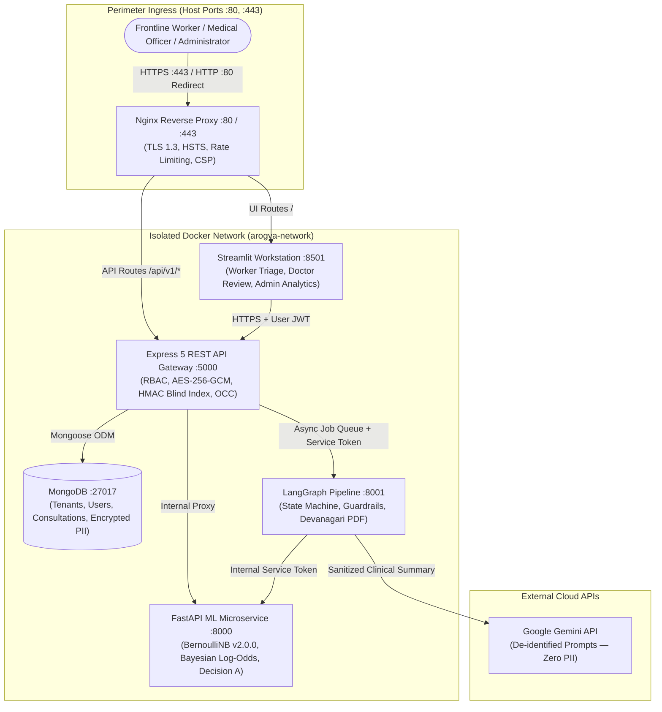
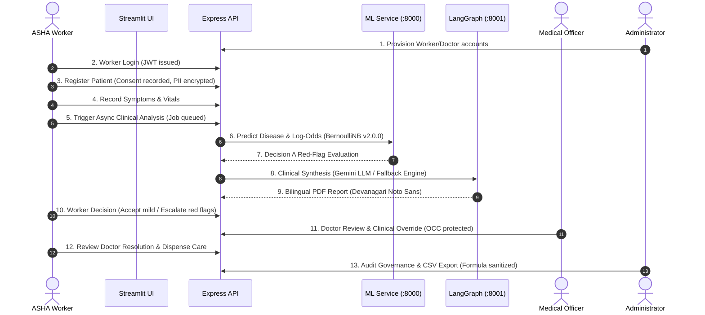

# 🏥 ArogyaMitra — Clinical Decision Support System for Rural Primary Triage

> **Clinical Decision Support Notice**: ArogyaMitra is a clinical decision-support (CDS) tool engineered for frontline health workers (ASHA/ANM) and Medical Officers in rural Primary Health Centres (PHCs). It is **not** an autonomous diagnostic system and does not replace registered medical practitioners. All machine learning predictions, red-flag alerts, and clinical guidance require human verification and clinical sign-off.

---

## 📌 System Architecture



### Architectural Guarantees
1. **Network Boundary**: Only ports `80` (HTTP redirect) and `443` (TLS 1.3 HTTPS) are exposed on the host. Microservice ports (`:5000`, `:8000`, `:8001`, `:27017`) reside strictly inside the isolated bridge network `arogya-network` (`docs/evidence/service_isolation.txt`).
2. **PII Confidentiality**: Patient identifying fields (`phoneNumber`, `address`, `medicalHistory`) are encrypted at rest with AES-256-GCM using unique IVs and authenticated tags (`docs/evidence/p1_verify_all.txt`).
3. **Exact Search**: Patient lookups utilize HMAC-SHA256 blind indexing on normalized phone numbers, preventing plaintext database indexing (`docs/evidence/p3_blind_index.txt`).
4. **Safety Intercepts**: Acute symptoms trigger Decision A automatic escalation. Frontline workers are blocked from accepting red-flag consultations (Decision B enforces HTTP 409 `RED_FLAG_ACCEPT_BLOCKED`).
5. **Fail-Closed Operations**: When internal microservices are offline, the backend returns HTTP 503 Service Unavailable rather than serving canned or mock clinical predictions (`docs/evidence/p0_docker_tests.txt`).

---

## 📋 The 13-Step Consultation Lifecycle



| Step | Phase | Role | Endpoint | Technical Governance | Status |
|---|---|---|---|---|---|
| **1** | Onboarding | Admin | `POST /api/v1/admin/worker` | Organization-scoped provisioning; Argon2id passwords. | **VERIFIED** |
| **2** | Authentication | Worker | `POST /api/v1/worker/login` | JWT access & refresh tokens with family reuse revocation. | **VERIFIED** |
| **3** | Patient Registration | Worker | `POST /api/v1/patient` | Multilingual DPDP consent; AES-256-GCM PII encryption; blind index. | **VERIFIED** |
| **4** | Consultation Intake | Worker | `POST /api/v1/consultation` | 131 canonical symptoms; vernacular selector (EN, HI, MR). | **VERIFIED** |
| **5** | Async Analysis | Worker | `POST /api/v1/consultation/:id/analyze/async` | UUID idempotency keys; non-blocking background queue. | **VERIFIED** |
| **6** | ML Inference | System | `POST /predict` (Internal) | BernoulliNB v2.0.0; additive Bayesian log-odds attributions. | **VERIFIED** |
| **7** | Decision A Intercept | System | Rule evaluation | 131 red-flag terms; forces `redFlag: true`, `needsEscalation: true`. | **VERIFIED** |
| **8** | LLM Synthesis | System | `POST /analyze/json` (Internal) | Gemini 1.5 Flash; PII sanitized; deterministic disease-tied fallback. | **VERIFIED** |
| **9** | PDF Generation | System | `POST /analyze/pdf` (Internal) | ReportLab; bundled Noto Sans Devanagari; bilingual layout. | **VERIFIED** |
| **10** | Worker Decision | Worker | `PATCH /api/v1/consultation/:id/accept` | Decision B rule: Red flags return HTTP 409 `RED_FLAG_ACCEPT_BLOCKED`. | **VERIFIED** |
| **11** | Doctor Second Opinion | Doctor | `PATCH /api/v1/consultation/:id/respond` | Mongoose OCC (`__v`); 50-way concurrent race protection. | **VERIFIED** |
| **12** | Worker Resolution | Worker | `GET /api/v1/consultation/:id` | Inspection of completed doctor prescription and guidance. | **VERIFIED** |
| **13** | Clinical Governance | Admin | `GET /api/v1/consultation/admin/analytics` | Audit trail inspection; CSV export formula injection protection. | **VERIFIED** |

*Detailed trace: [`docs/FLOW_TRACE.md`](file:///d:/Document/Projects/Internship/Arogyamitra/docs/FLOW_TRACE.md).*

---

## 🚀 Quickstart Guides

### Prerequisites
- **Operating System**: Windows 10/11, Ubuntu 22.04+, or macOS
- **Container Runtime**: Docker Desktop v24+ (with Docker Compose v2)
- **Node.js**: v22 LTS (for native script execution)
- **Python**: v3.11+ (with `uv` package manager)
- **PowerShell**: v5.1 or v7+ (for Windows automation scripts)

---

### Option 1: Docker Compose Stack (Recommended)

#### Step 1: Clone and Configure Environment
```bash
git clone <repository-url>
cd Arogyamitra
cp .env.example .env
```
Ensure required secrets (`JWT_SECRET`, `REFRESH_TOKEN_SECRET`, `ENCRYPTION_KEY`, `BLIND_INDEX_KEY`, `INTERNAL_SERVICE_SECRET`, `GEMINI_API_KEY`) are present in `.env`.

#### Step 2: Build and Launch Containers
```powershell
docker compose up --build -d
```

#### Step 3: Verify Container Health
```powershell
docker compose ps
```
Ensure all 6 services report status `healthy`:
- `arogya-proxy` (ports 80, 443)
- `arogya-frontend` (internal 8501)
- `arogya-backend` (internal 5000)
- `arogya-ml` (internal 8000)
- `arogya-graph` (internal 8001)
- `arogya-mongo` (internal 27017)

#### Step 4: Seed Database
Run the automated Docker seeding script:
```powershell
powershell -ExecutionPolicy Bypass -File scripts/seed_docker.ps1
```

#### Step 5: Access System
- **Web Workstation**: Open [https://localhost](https://localhost) (Accept local development certificate).
- **Backend Health**: `curl -k https://localhost/api/v1/health`

---

### Option 2: Native Local Development

For direct debugging without Docker containers:
```powershell
# 1. Start local services (binds to 127.0.0.1)
powershell -ExecutionPolicy Bypass -File scripts/start_local.ps1

# 2. Seed local MongoDB instance
node Backend/src/scripts/seedDemo.js

# 3. Stop local services
powershell -ExecutionPolicy Bypass -File scripts/stop_local.ps1
```
Local service ports:
- Express API: `http://127.0.0.1:5000`
- ML Service: `http://127.0.0.1:8000`
- LangGraph Service: `http://127.0.0.1:8001`
- Streamlit UI: `http://127.0.0.1:8501`

---

## 👥 Seeded User Accounts & Roles

The database seed initializes three role-segregated accounts within organization `PHC-DEMO-001`:

| Role | Email | Password | Permissions & Scope |
|---|---|---|---|
| **Frontline Worker** | `worker@arogyamitra.gov.in` | `Worker@Arogya2026!` | Patient registration, symptom triage intake, async job trigger, mild case acceptance, doctor escalation. Cannot override red flags or view admin metrics. |
| **Medical Officer** | `doctor@arogyamitra.gov.in` | `Doctor@Arogya2026!` | Queue review, red-flag override (with mandatory clinical note), diagnosis sign-off, prescription issuance. Cannot modify organization settings. |
| **System Admin** | `admin@arogyamitra.gov.in` | `Admin@Arogya2026!` | Personnel onboarding, audit log inspection, system analytics, formula-sanitized CSV export. Cannot perform clinical patient triage. |

---

## 🧪 Testing & Verification Suites

### 1. Complete Unit & Integration Suite (283 Tests)
Runs linting, ML property tests, Backend security tests, LangGraph guardrails, and Streamlit AppTests:
```powershell
powershell -ExecutionPolicy Bypass -File scripts/verify_all.ps1
```
*Breakdown*:
- **ML_Model Tests**: 55 passed (`verify_ml.txt`)
- **Backend Tests**: 191 passed (`verify_backend.txt`)
- **Graph Tests**: 22 passed (`verify_graph.txt`)
- **UI Tests**: 15 passed (`verify_ui.txt`)
- **Total**: 283 passed, 0 failed.

### 2. End-to-End Browser Automation (Playwright)
Executes all 10 clinical workflow scenarios against the live Docker stack at `https://localhost`:
```bash
node scripts/test_p4_playwright_suite.mjs
```
Captures 10 full-page screenshots to `docs/evidence/ui_screenshots/` (`playwright_report.txt`).

### 3. Ingress Load & Concurrency Benchmark
Evaluates 2,400 requests across 4 endpoints under concurrency levels 1, 10, and 50:
```bash
python scripts/run_p5_load_test.py
```
Outputs latency distributions (p50, p90, p95, p99) and error rates to `docs/evidence/load_test_results.txt`.

### 4. Man-In-The-Middle (MITM) Security Probe
Validates HTTP-to-HTTPS 301 redirection, untrusted CA rejection, verified CA handshake, and TLS 1.3 cipher suite:
```bash
python scripts/test_p6_mitm_demo.py
```
Outputs proof to `docs/evidence/mitm_demo.txt`.

### 5. Master Reproduction Suite
Executes end-to-end container rebuild, database seeding, test execution, browser automation, load testing, MITM verification, and security scanning in a single pipeline:
```powershell
powershell -ExecutionPolicy Bypass -File scripts/reproduce_all.ps1
```
Outputs full reproduction log to `docs/evidence/reproduce_all.txt`.

---

## 🔬 Technical Specifications

### Machine Learning Engine
- **Active Model**: Bernoulli Naive Bayes (`v2.0.0`) on 41 disease classes and 131 symptoms (`ML_Model/model/v2/model.joblib`).
- **Feature Attributions**: Additive Bayesian Log-Odds Evidence Weights ($\sum \Delta w_j = \Delta \log P \pm 10^{-10}$).
- **Escalation Policy**: Evaluates held-out operating threshold of 0.75 confidence and 131 red-flag symptoms.
- **Scientific Transparency**: Probabilities represent raw model likelihoods and are labeled "Model Confidence" without false calibration claims (`docs/MODEL_CARD.md`).

### Security Scanners & Hygiene
- **Secret Detection**: `gitleaks detect` scanned 32 commits (0 leaks found).
- **Node Dependencies**: `npm audit` on production dependencies (0 vulnerabilities).
- **Python Dependencies**: `pip-audit` on virtual environment (0 vulnerabilities).
- **Container Filesystems**: `trivy fs .` across lockfiles (0 vulnerabilities).
- **Python Static Analysis**: `bandit` across codebase (0 vulnerabilities).
- **Workflow Linter**: `actionlint` across GitHub Actions workflows (0 errors).

---

## 📚 Technical Documentation Index

- **Academic Viva Guide (42 Questions)**: [`docs/VIVA_QA.md`](file:///d:/Document/Projects/Internship/Arogyamitra/docs/VIVA_QA.md)
- **Claims Trace Matrix**: [`docs/CLAIMS_TRACE.md`](file:///d:/Document/Projects/Internship/Arogyamitra/docs/CLAIMS_TRACE.md)
- **Evidence Index**: [`docs/EVIDENCE_INDEX.md`](file:///d:/Document/Projects/Internship/Arogyamitra/docs/EVIDENCE_INDEX.md)
- **Known Limitations & Medical Disclosures**: [`docs/KNOWN_LIMITATIONS.md`](file:///d:/Document/Projects/Internship/Arogyamitra/docs/KNOWN_LIMITATIONS.md)
- **Academic Literature Review**: [`docs/LITERATURE_REVIEW.md`](file:///d:/Document/Projects/Internship/Arogyamitra/docs/LITERATURE_REVIEW.md)
- **Threat Model & Security Matrix**: [`docs/THREAT_MODEL.md`](file:///d:/Document/Projects/Internship/Arogyamitra/docs/THREAT_MODEL.md)
- **Clinical Model Card**: [`docs/MODEL_CARD.md`](file:///d:/Document/Projects/Internship/Arogyamitra/docs/MODEL_CARD.md)
- **13-Step Flow Trace**: [`docs/FLOW_TRACE.md`](file:///d:/Document/Projects/Internship/Arogyamitra/docs/FLOW_TRACE.md)
- **Completion Ledger**: [`docs/COMPLETION_LEDGER.md`](file:///d:/Document/Projects/Internship/Arogyamitra/docs/COMPLETION_LEDGER.md)

---

## 📜 Licensing & Typography Notice

ArogyaMitra is developed for healthcare decision support research. Bundled Devanagari typography (`Noto Sans Devanagari`) is distributed under the SIL Open Font License (OFL) v1.1. Clinical safety rules reflect published primary health center triage guidelines.
