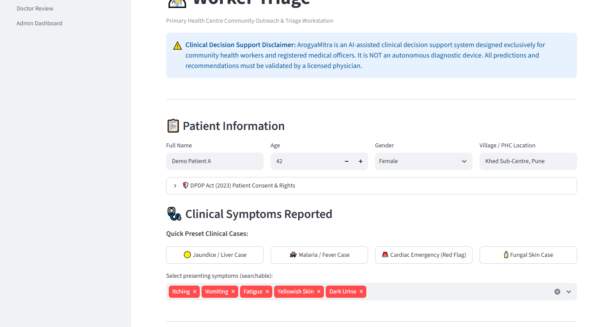
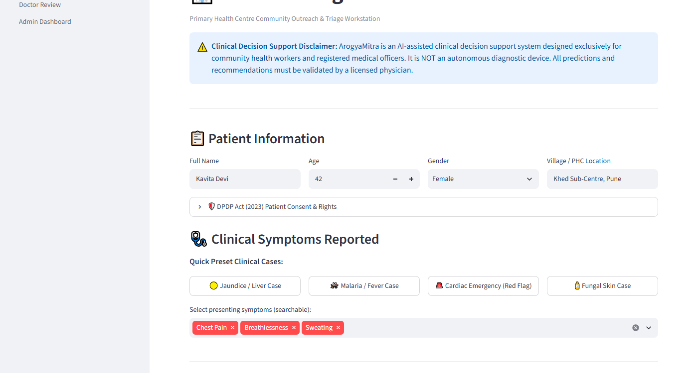
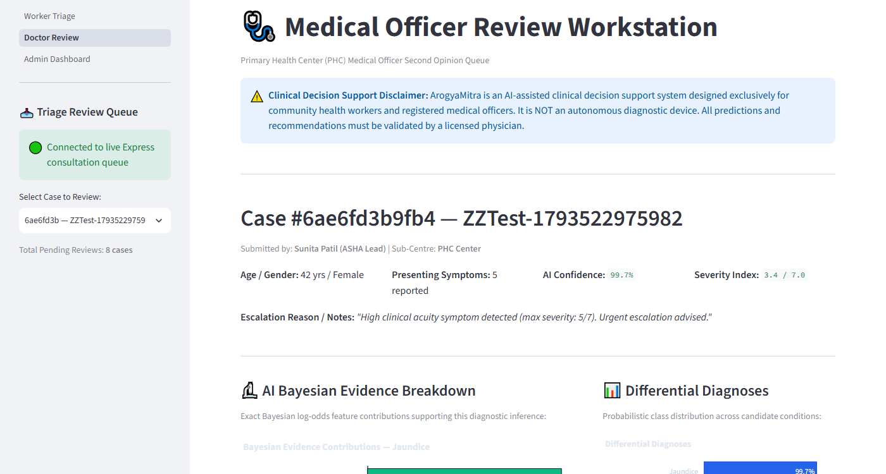
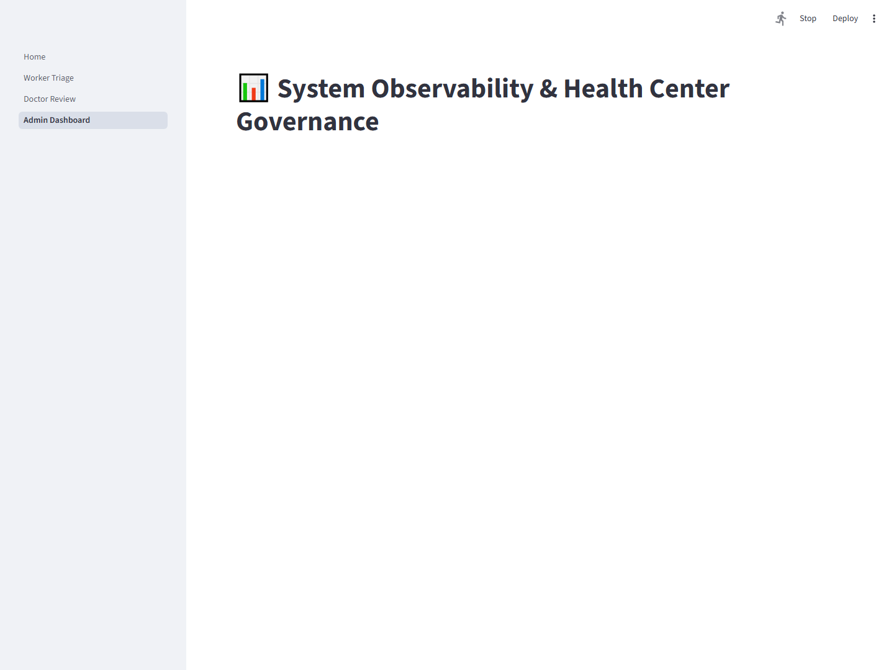
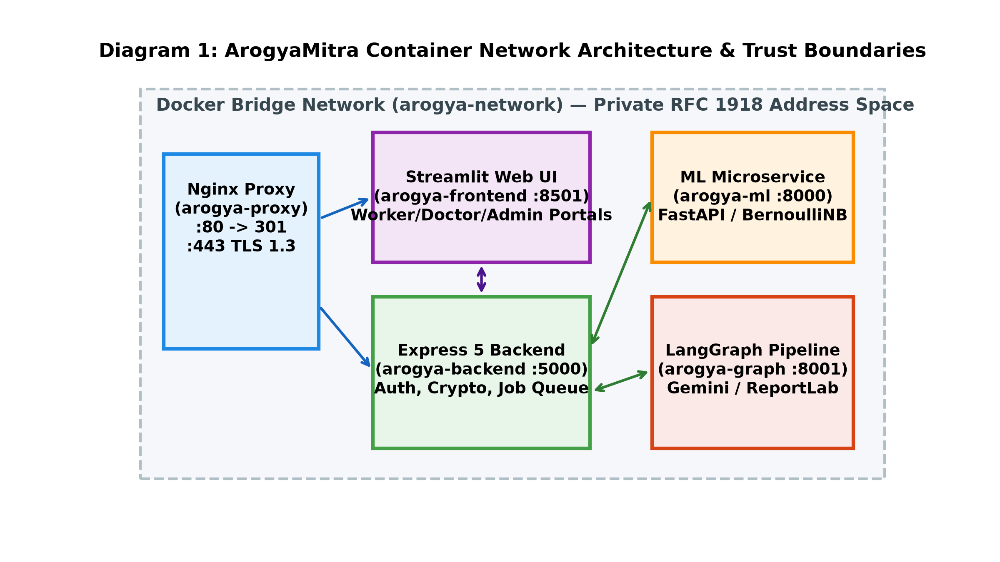

# ArogyaMitra

A secure, explainable, fail-closed AI-assisted primary-healthcare decision-support prototype.

> [!WARNING]
> **ACADEMIC & RESEARCH PROTOTYPE DISCLAIMER**
> - **Synthetic Dataset Only**: Trained and evaluated strictly on a synthetic benchmark (304 unique symptom vectors across 41 disease classes, derived by removing 4,616 exact duplicates from an uncurated 4,920-row dataset).
> - **Not Clinically Validated**: This software has not undergone clinical trials, has not processed live patient data, and is **not a certified medical device** under CDSCO or FDA frameworks. It must **not** be used for autonomous diagnosis or real patient care.
> - **Draft Safety Rules**: The 7 emergency red-flag triggers and fallback templates are **DRAFT** engineering specifications pending formal clinical board review.
> - **Uncalibrated Confidence**: Machine learning confidence scores are uncalibrated Bayesian posterior estimates, not calibrated clinical probabilities.

---

## What It Does

1. **Frontline Worker Triage**: Community health workers (ASHAs) input patient symptoms into an accessible, multilingual interface.
2. **Deterministic Red-Flag Override**: Evaluates symptoms against 7 critical emergency triggers (e.g., chest pain, breathlessness, coma); if present, immediately forces emergency status and blocks frontline acceptance.
3. **Transparent ML Inference**: Predicts Top-3 condition differentials via a stateless Bernoulli Naive Bayes model with exact additive log-odds feature attributions ($\sum \Delta w_j = \Delta \log P$).
4. **Guarded Narrative Synthesis ("Safe Mode")**: Generates patient guidance via Large Language Models with whole-phrase confidence filtering, 10s per-call timeouts, and a 20s hard cap; falls back deterministically to pre-compiled clinical templates if the LLM is absent or slow.
5. **Two-Tier Consultation Lifecycle**: Mild cases can be accepted by workers; emergency red flags strictly require escalation to a Medical Officer. Accepting a red-flag consultation is hard-blocked with HTTP 409.
6. **Physician Second Opinion & Governance**: Medical Officers review escalated queues, apply clinical overrides, and issue prescriptions under optimistic concurrency control; all events append to an immutable audit trail.
7. **Fail-Closed Availability**: If the ML or downstream services are unreachable, the backend fails closed (HTTP 503) rather than generating ungrounded advice.

---

## Clinical Workflow Demonstration

| Worker Differential & Attribution | Red-Flag Block (HTTP 409 Conflict) |
| :---: | :---: |
|  |  |
| *Differential diagnosis & additive evidence* | *Frontline accept blocked; escalation mandatory* |

| Medical Officer Review Queue | Administrator Security & Audit Dashboard |
| :---: | :---: |
|  |  |
| *Live doctor triage queue & prescription entry* | *Real consultation metrics & security audit trail* |

---

## System Architecture



### Container Services & Network Topology

Only ports `80` and `443` are published to the host. All internal microservices communicate over the isolated Docker bridge network `arogya-network`:

| Container Name | Service Role | Technology Stack | Host Ports | Internal Port |
| :--- | :--- | :--- | :--- | :--- |
| `arogya-proxy` | Edge Reverse Proxy & TLS Termination | Nginx 1.27 Alpine | `80:80`, `443:443` | `80`, `443` |
| `arogya-frontend` | Thin-Client User Workstation | Streamlit (Python 3.11) | None | `8501` |
| `arogya-backend` | Core REST API Gateway & Security Layer | Express 5 / Node.js 22 | None | `5000` |
| `arogya-ml` | Statistical Inference & Attribution Engine | FastAPI / scikit-learn | None | `8000` |
| `arogya-graph` | LLM Guardrails & Bilingual PDF Generator | FastAPI / LangGraph / Gemini | None | `8001` |
| `arogya-mongo` | Isolated Encrypted Data Tier | MongoDB 7.0 | None | `27017` |

### Hierarchical Request Timeout Budgets
$$\text{Nginx Ingress (90s)} > \text{Backend Gateway (30s)} > \text{LangGraph Total Cap (20s)} \ge \text{Per-Attempt LLM Timeout (10s)}$$

---

## Quick Start

### 1. Prerequisites
- **Docker Desktop** v24+ with Compose v2
- **PowerShell** 5.1+ (Windows) or **Bash** (Linux/macOS)
- Node.js 22 LTS and Python 3.11+ (only needed for native host test scripts)

### 2. Configure Environment Variables
Copy the template configuration:
```bash
cp .env.example .env
```
Fill required configuration values in `.env` (names and placeholders matching `.env.example`):
- `JWT_SECRET`: `replace_with_a_secure_random_string_at_least_32_characters_long`
- `LLM_API_KEY`: `your_google_gemini_api_key_here` *(Optional: Google Gemini API key. If unset or invalid, the system automatically engages deterministic clinical template fallback "Safe Mode" without failure).*
- `LLM_MODEL`: `gemini-1.5-flash`

### 3. Launch Container Stack
```powershell
docker compose up -d --build
```

### 4. Verify Service Health
```powershell
powershell -File scripts/health_check.ps1
```
All 6 microservices must report `HEALTHY`.

### 5. Access the Web Workstation
Open **[https://localhost](https://localhost)** in your browser.  
*(Note: ArogyaMitra uses a self-signed TLS certificate for local evaluation; acknowledge the browser certificate warning to proceed).*

### 6. Seed, Reset & Teardown
- **Seed initial demo state**: `powershell -File scripts/seed_docker.ps1`
- **Reset to clean 0-consultation state** (keeps seed users): `powershell -File scripts/reset_demo.ps1`
- **Stop container stack**: `docker compose down`

### Demo Credentials (Evaluation Only)
| Role | Email | Password | Allowed Scope |
| :--- | :--- | :--- | :--- |
| **Health Worker** | `worker@arogyamitra.gov.in` | `Worker@123` | Patient intake, symptom triage, accept mild case, escalate |
| **Medical Officer** | `doctor@arogyamitra.gov.in` | `Doctor@123` | Queue inspection, clinical sign-off, prescription, overrides |
| **System Admin** | `admin@arogyamitra.gov.in` | `Admin@123` | Real-time system analytics, live security audit trail, session revocation |

---

## Demo Walkthrough (6 Steps)

1. **Sign in as Worker**: Log in to `https://localhost` using `worker@arogyamitra.gov.in` / `Worker@123` and select **Worker Triage**.
2. **Submit Mild Consultation**: Enter patient demographics, select symptoms (e.g., `itching`, `skin_rash`), and click **Run AI Diagnostic Analysis**.
3. **Accept Mild Case**: Review Top-3 predictions and feature attribution; click **Accept & File Consultation** (case status transitions to `closed`).
4. **Trigger Red-Flag Block**: Start a new consultation with emergency symptoms (e.g., `chest_pain`, `breathlessness`, or `coma`); note that the **Accept** button is blocked (HTTP 409) with a critical emergency banner.
5. **Escalate to Doctor**: Enter clinical notes and click **Escalate to Medical Officer** (status transitions to `escalated`).
6. **Doctor Review & Worker Verification**: In a new tab/session, sign in as `doctor@arogyamitra.gov.in` / `Doctor@123`, open **Doctor Review**, select the patient, input notes/prescription, and submit. Re-check the Worker dashboard to see status updated to `reviewed`.

---

## Automated Verification

The test and security verification suites execute against live services without manual intervention:

```powershell
# 1. Complete Unit & Integration Suite (322 tests: ML 55, Backend 231, Graph 26, UI 10)
powershell -File scripts/verify_all.ps1

# 2. Golden Clinical Set (20/20 validated benchmark cases)
python scripts/test_p0_golden_set.py

# 3. Playwright End-to-End User Journeys (11/11 browser journeys)
node scripts/test_p4_playwright_suite.mjs

# 4. Concurrency & Load Benchmark (2,400 requests across 50 users in test mode)
python scripts/run_p5_load_test_testmode.py

# 5. Container Security Vulnerability Scan (Trivy)
powershell -File scripts/run_trivy_scan_all.ps1
```
*All raw output logs are archived in [`docs/evidence/`](docs/evidence/).*

---

## Empirical Evaluation Summary

> *Notice: Benchmarks conducted on synthetic datasets; results do not represent clinical validation.*

| Metric / Benchmark | BernoulliNB | LightGBM | XGBoost | Source Evidence |
| :--- | :--- | :--- | :--- | :--- |
| **Top-1 Accuracy (0% Dropout)** | **1.000 ± 0.000** | 0.989 ± 0.012 | 0.984 ± 0.015 | `docs/evidence/cv_benchmark_results.json` |
| **Top-1 Accuracy (30% Dropout)** | **0.989 ± 0.014** | 0.864 ± 0.027 | 0.868 ± 0.025 | `docs/evidence/cv_benchmark_results.json` |
| **Top-1 Accuracy (50% Dropout)** | **0.919 ± 0.023** | 0.683 ± 0.038 | 0.720 ± 0.032 | `docs/evidence/cv_benchmark_results.json` |
| **Expected Calibration Error (ECE - 50%)** | **0.081** | 0.317 | 0.280 | `docs/evidence/ece_evaluation_results.json` |
| **Platt Scaling Log Loss** | **0.0061 (Raw)** | — | — | Worsened to 0.1643 with sigmoid; raw scores retained |
| **System Throughput (50 Concurrency)** | **14.7 req/s** | — | — | 100% HTTP 200 across 2,400 requests (`docs/evidence/load_test_results.txt`) |
| **Worker List Latency (p50 / p99)** | **76.2 ms / 57.0 ms** | — | — | Optimized from 193.0 ms / 248.0 ms via pagination & projection |
| **Container Vulnerabilities (Trivy)** | **0 fixable High/Crit** | — | — | `trivy image --ignore-unfixed` across all 4 production images |
| **OWASP ZAP Dynamic Baseline** | **0 Fail / 6 Warn** | — | — | Passive unauthenticated proxy scan across 68 endpoints |

---

## Security Architecture

- **Authentication**: Passwords hashed with Argon2id (3 iterations, 64 MB RAM, 4 threads); dual-token JWT architecture (15-min access, 7-day refresh token rotation).
- **Role-Based Access Control (RBAC)**: Strict separation between Frontline Worker, Medical Officer, and System Administrator.
- **Data Protection at Rest**: Patient identifying fields encrypted using AES-256-GCM with distinct initialization vectors per record; searchable phone numbers indexed via HMAC-SHA256 blind indexing.
- **Concurrency & Web Hardening**: Optimistic Concurrency Control (`__v` version key) on all consultation transitions; HTTP security headers via Helmet; strict CORS; rate-limiting per IP; append-only audit trail logging.
- **DPDP Act Alignment**: DPDP-aware data consent handling with administrative approvals required for permanent patient data erasure. *(Not certified HIPAA/DPDP compliant)*.

---

## Known Limitations

1. **Synthetic Data**: The underlying training dataset is synthetic; it cannot capture real-world co-morbidities, atypical disease presentations, or epidemiological prevalence.
2. **Conditional Independence & Overconfidence**: Bernoulli Naive Bayes treats symptoms as conditionally independent, concentrating posterior probabilities toward 0 and 1. Scores are strictly uncalibrated relative confidence estimates.
3. **Draft Rules & Templates**: The 7 emergency red-flag triggers and deterministic fallback clinical precautions are draft engineering prototypes pending physician panel approval.
4. **Self-Signed TLS**: Default local deployment utilizes a self-signed certificate requiring manual trust configuration.
5. **Single-Node Deployment**: Single container replicas managed via Docker Compose without distributed clustering or automatic horizontal scaling.
6. **In-Memory Rate Limiting**: Request limiters run in-memory within Node.js processes rather than across a synchronized Redis cluster.
7. **Devanagari PDF Typography**: Multilingual PDF rendering uses ReportLab without HarfBuzz complex shaping, which may result in imperfect ligature placement in Hindi and Marathi text.

---

## Repository Structure

- `Backend/`: Express 5 REST API gateway, authentication, AES-256-GCM encryption, and consultation lifecycle
- `ML_Model/`: FastAPI microservice, scikit-learn BernoulliNB model (`v2.0.0`), and Bayesian log-odds attribution
- `graph/`: FastAPI + LangGraph orchestration, LLM narrative synthesis, prompt injection defense, and PDF generation
- `ui/`: Streamlit thin-client multi-page application (Worker Triage, Doctor Review, Admin Dashboard)
- `deploy/`: Nginx reverse proxy configuration, TLS certificates, and edge security headers
- `config/`: Clinical red-flags rules and shared configuration (`red_flags.yaml`)
- `docs/`: Academic project report, architectural diagrams, threat model, model card, and verification logs
- `scripts/`: Automated testing suites, database seeding, benchmarking, and verification runners

---

## Documentation Links

- 📄 **[Final Academic Report (PDF)](docs/REPORT_FINAL/ArogyaMitra_BTech_Project_Report.pdf)**
- 📋 **[Model Card (BernoulliNB v2.0.0)](docs/MODEL_CARD.md)**
- ⚠️ **[Known Limitations & Disclosures](docs/KNOWN_LIMITATIONS.md)**
- 🚨 **[Clinical Red-Flag Review](docs/RED_FLAG_REVIEW.md)**
- 🛠️ **[Project Handover & Reproduction Dossier](docs/HANDOVER.md)**

---

## Authors & Academic Credits

- **Author**: Satyam Keshari (B.Tech Computer Science and Engineering, IIIT Pune)
- **Project Supervisor**: Dr. Ashish Singh (Adjunct Assistant Professor, Department of Electronics and Communication Engineering, IIIT Pune)

---

## License

No license is currently specified. All rights are reserved by the author. This repository is published strictly for academic capstone project evaluation.
