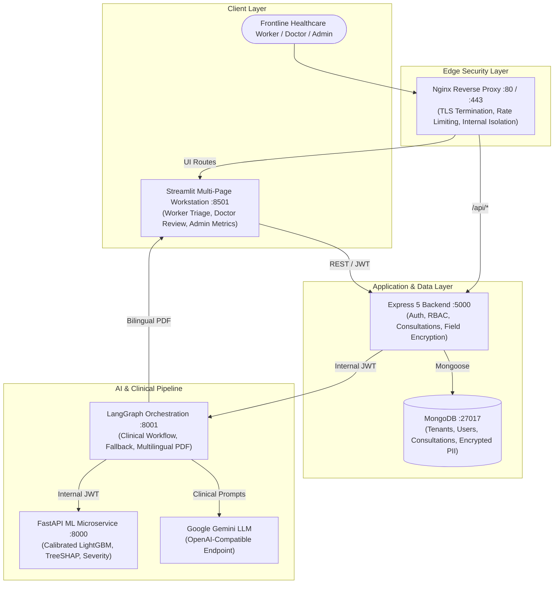

# 🏥 ArogyaMitra — AI-Assisted Primary Healthcare Decision Support System

> **⚠️ Clinical Decision Support Disclaimer**: ArogyaMitra is an AI-assisted clinical decision-support system designed to assist frontline healthcare workers in rural and primary healthcare centers (PHCs). It is **not** a replacement for licensed medical doctors or definitive clinical diagnoses. All predictions, severity flags, and clinical recommendations require human review and medical validation.

---

## 📌 Architecture & System Flow



---

## ⚡ Unified Verification Runner

A single command verifies all 5 engineering tiers (Lint, ML Contract, Backend Security/Concurrency, Graph Pipeline, UI AppTests):

```powershell
# PowerShell (Windows)
powershell -ExecutionPolicy Bypass -File scripts/verify_all.ps1

# Bash (Linux / macOS)
bash scripts/verify_all.sh
```

---

## 🚀 Setup & Execution

### 1. Automated Stack (Docker Compose)
*Requires Docker Desktop with Linux containers enabled and >= 10 GB free virtualization disk.*

```bash
# 1. Clone repository
git clone https://github.com/satyam7535/ArogyaMitra.git && cd ArogyaMitra

# 2. Configure environment secrets
cp .env.example .env

# 3. Launch isolated container stack
docker compose up --build -d

# 4. Verify edge proxy and health endpoints
curl -k https://localhost/health
```

---

### 2. Native Local Development (Manual Setup)

#### Prerequisites
- **Node.js**: v20+ (v22 recommended)
- **Python**: v3.11+
- **MongoDB**: v6.0+ (running on `localhost:27017`)

---

#### Step 1: Backend Express Gateway
```bash
cd Backend
cp .env.example .env
npm ci
npm run dev
# Server listens on http://localhost:5000
# Healthcheck: http://localhost:5000/health
```

---

#### Step 2: ML Diagnostic Microservice
```bash
cd ML_Model
cp .env.example .env
pip install -r requirements.txt
uvicorn app:app --host 0.0.0.0 --port 8000 --reload
# Server listens on http://localhost:8000
# Healthcheck: http://localhost:8000/health
```

---

#### Step 3: LangGraph Clinical Reasoning Service
```bash
cd graph
cp .env.example .env
pip install -r requirements.txt
uvicorn server:app --host 0.0.0.0 --port 8001 --reload
# Server listens on http://localhost:8001
# Healthcheck: http://localhost:8001/health
```

---

#### Step 4: Streamlit Clinical Workstation
```bash
cd ui
cp .env.example .env
pip install -r requirements.txt
streamlit run Home.py --server.port 8501
# Application loads on http://localhost:8501
# (Legacy React frontend is archived in legacy/frontend)
```

---

## 🤖 LLM Provider Configuration

ArogyaMitra exclusively uses **Google Gemini** through its free-tier OpenAI-compatible endpoint:
- **Base URL**: `https://generativelanguage.googleapis.com/v1beta/openai/`
- **Default Model**: `gemini-1.5-flash`
- **Environment Variables**:
  - `LLM_API_KEY`: Your Gemini API key.
  - `LLM_BASE_URL`: OpenAI-compatible Gemini URL.
  - `LLM_MODEL`: Target Gemini model (`gemini-1.5-flash` or `gemini-2.0-flash`).

*Patient data privacy*: In accordance with privacy and data minimization principles, personally identifiable information (patient names, phone numbers, addresses) is never transmitted to external LLM providers.

---

## 📊 Prediction Contract (`POST /predict`)

The ML microservice exposes `POST /predict` adhering to this strict contract:

```json
{
  "primaryDiagnosis": "Fungal infection",
  "confidenceScore": 92.5,
  "severityScore": 2.67,
  "topPredictions": [
    { "disease": "Fungal infection", "confidence": 92.5 },
    { "disease": "Allergy", "confidence": 4.2 },
    { "disease": "GERD", "confidence": 1.1 }
  ],
  "matchedSymptoms": ["itching", "skin_rash"],
  "unmatchedSymptoms": [],
  "symptomSeverities": [
    { "symptom": "itching", "severity": 1 },
    { "symptom": "skin_rash", "severity": 3 }
  ],
  "precautions": ["bath twice", "use dettol or neem in bathing water"],
  "description": "Fungal infection is a common skin condition...",
  "limeExplanation": [
    { "feature": "skin_rash present", "impact": 0.45, "direction": "Supports Diagnosis" }
  ],
  "patientName": "Sunita Patil",
  "patientAge": 38,
  "patientGender": "Female",
  "workerName": "Asha Worker Anita",
  "location": "Wardha PHC"
}
```

---

## 📁 Repository Structure

```
ArogyaMitra/
├── Backend/                 # Express 5 + Mongoose 9 REST API
│   ├── src/                 # Controllers, models, routes, middlewares
│   ├── Dockerfile
│   └── package.json
├── Frontend/                # React 19 + Vite + Tailwind CSS
│   ├── src/                 # Pages, components, locales (en, hi, mr)
│   ├── Dockerfile
│   └── package.json
├── ML_Model/                # FastAPI Machine Learning Service
│   ├── app.py               # Prediction API endpoint
│   ├── dataset/             # Kaggle symptom-disease datasets
│   ├── model/               # Serialized model artifacts (.pkl, .json)
│   ├── scripts/             # Training and setup scripts
│   ├── Dockerfile
│   └── requirements.txt
├── graph/                   # LangGraph AI Pipeline & PDF Generator
│   ├── nodes/               # Graph execution nodes (XAI, LLM, PDF)
│   ├── utils/               # PDF generator with ReportLab
│   ├── server.py            # FastAPI server
│   ├── Dockerfile
│   └── requirements.txt
├── docs/                    # Architecture, Decisions, and Progress
│   ├── DECISIONS.md         # Architecture Decision Records (ADRs)
│   ├── PROGRESS.md          # Phased engineering task logs
│   └── evidence/            # Empirical benchmarks and test logs
├── docker-compose.yml       # Production baseline orchestration stack
└── .editorconfig            # Code style and formatting standards
```
