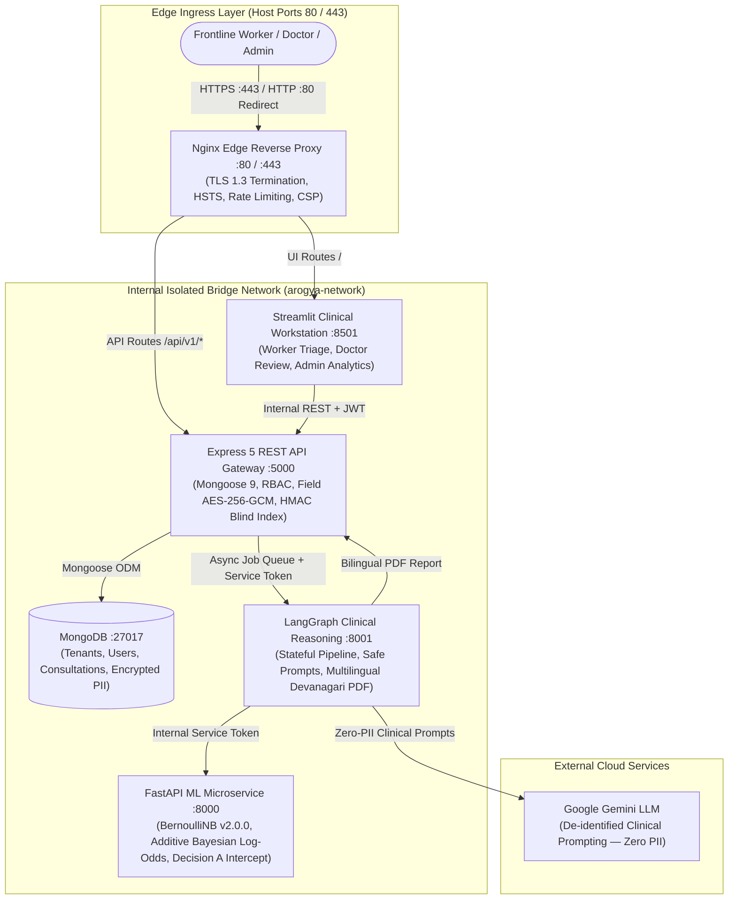

# 🏥 ArogyaMitra — AI-Assisted Primary Healthcare Decision Support System

> **⚠️ Clinical Decision Support Disclaimer**: ArogyaMitra is an AI-assisted clinical decision-support (CDS) system specifically engineered for frontline healthcare workers (ASHA / ANM) and medical officers in rural primary healthcare centers (PHCs). It is **not** a replacement for licensed medical practitioners or definitive clinical diagnoses. All machine learning predictions, severity flags, and AI-generated clinical summaries require mandatory human verification and medical sign-off.

---

## 📌 Architecture Overview



### Key Security & Isolation Guarantees
- **Strict Network Isolation**: Only the Nginx reverse proxy binds to public host ports (`80` and `443`). All internal microservices (`backend:5000`, `ui:8501`, `ml:8000`, `graph:8001`, `mongo:27017`) reside exclusively on an internal bridge network (`arogya-network`) without host port bindings. Direct external access to `/predict` or `/analyze` is rejected with `403 Forbidden`.
- **Zero PII Transmission**: Patient identifiable information (name, phone number, address) is encrypted at rest with AES-256-GCM and never leaves the backend boundary. LLM prompts and ML inference receive strictly de-identified symptom tokens and clinical vitals.
- **HMAC Blind Indexing**: Exact-match patient lookups and duplicate detection operate over SHA-256 HMAC blind indexes, preventing plaintext database searches or leakage in index trees.
- **Fail-Closed Clinical Safety**: High-acuity symptoms (`chest_pain`, `breathlessness`, etc.) automatically trigger Decision A red flags. Frontline workers cannot accept high-acuity cases directly (Decision B enforces HTTP 409 `RED_FLAG_ACCEPT_BLOCKED`), requiring mandatory doctor escalation or emergency hospital referral.

---

## 📋 The 13-Step Clinical & Operational Lifecycle

| Step | Phase | Role | Action & Endpoint | Governance & Technical Control |
|---|---|---|---|---|
| **1** | Onboarding | Admin | `POST /api/v1/admin/worker`<br>`POST /api/v1/admin/doctor` | Creates healthcare personnel scoped strictly to admin's organization (`orgId`). Password reset links isolated to development console. |
| **2** | Authentication | Worker | `POST /api/v1/worker/login`<br>`GET /api/v1/consultation/my` | Authenticates worker, issues canonical JWT, loads dashboard scoped strictly to worker's facility. |
| **3** | Patient Registration | Worker | `POST /api/v1/patient` | Records patient details; encrypts PII (`phoneNumber`, `address`, `medicalHistory`) with AES-256-GCM at rest; records DPDP consent metadata; verifies document magic-bytes. |
| **4** | Consultation Intake | Worker | `POST /api/v1/consultation` | Records presenting symptoms via 131-symptom searchable vernacular selector (English, Hindi, Marathi); attaches clinical vitals. |
| **5** | Async Analysis | Worker / System | `POST /api/v1/consultation/:id/analyze/async`<br>`GET /api/v1/consultation/:id/analyze/status/:jobId` | Enqueues background analysis job with idempotency keys and atomic MongoDB lease claims (`findOneAndUpdate`); returns 202 Accepted. |
| **6** | ML Inference | ML Microservice | `POST /predict` (Internal) | Bernoulli Naive Bayes (`v2.0.0`) computes estimated class probabilities and exact mathematical Additive Bayesian Log-Odds ($\Delta w_{c,j}$) feature attributions. |
| **7** | Decision A Intercept | Safety Rule Engine | Runtime validation against `config/red_flags.yaml` | Automatically intercepts severe symptoms; forces `redFlag: true`, `needsEscalation: true`, and assigns `risk: "High"`. |
| **8** | LLM Synthesis | LangGraph Engine | `POST /analyze/json` (Internal) | Generates structured bilingual clinical guidance via Google Gemini using de-identified prompts; guarded by 20-attack prompt injection defense and deterministic fallback. |
| **9** | PDF Generation | LangGraph Engine | `POST /analyze/pdf` (Internal) | Renders comprehensive bilingual clinical summary PDF with bundled Noto Sans Devanagari typography, emergency banners, and log-odds charts. |
| **10** | Worker Decision | Worker | `PATCH /api/v1/consultation/:id/accept`<br>`PATCH /api/v1/consultation/:id/escalate` | Frontline decision workflow: Accept mild cases, escalate to doctor, or refer to hospital. **Decision B Rule**: Attempting to accept a red-flag case returns `409 Conflict` (`RED_FLAG_ACCEPT_BLOCKED`). |
| **11** | Doctor Second Opinion | Doctor | `GET /api/v1/consultation/pending`<br>`PATCH /api/v1/consultation/:id/respond` | Doctor reviews pending triage queue, overdue badges (>24h), and provides diagnosis. Enforces Mongoose Optimistic Concurrency Control (`optimisticConcurrency: true`) detecting version collisions (`409 Conflict`). |
| **12** | Worker Resolution | Worker | `GET /api/v1/consultation/:id` | Worker reviews the completed second opinion, prescription guidance, and dispenses local care. |
| **13** | Clinical Governance | Admin | `GET /api/v1/consultation/admin/analytics`<br>`GET /api/v1/admin/audit-logs` | Admin monitors operational metrics: red-flag volume, Decision B override tallies, doctor turnaround latency, AI-vs-doctor diagnostic agreement, and exports sanitized CSV. |

---

## 🚀 Execution & Setup Guide

### Method A: Production Container Stack (Docker Compose) — *Recommended*

The Docker Compose configuration orchestrates all 6 services with internal networking and edge Nginx proxying.

#### 1. Prerequisites
- Docker Desktop v24+ (with Linux container engine and Compose v2)
- At least 8 GB free host memory and 10 GB disk space

#### 2. Environment Configuration
Copy `.env.example` to `.env` in the repository root:
```bash
cp .env.example .env
```
Ensure secrets (`JWT_SECRET`, `REFRESH_TOKEN_SECRET`, `ENCRYPTION_KEY`, `INTERNAL_SERVICE_SECRET`, and `LLM_API_KEY`) are populated.

#### 3. Build & Start Stack
```powershell
# Windows PowerShell
docker compose up --build -d

# Linux / macOS
docker compose up --build -d
```

#### 4. Verify Stack Status & Ingress
```powershell
# Check running containers
docker compose ps

# Verify Edge Reverse Proxy HTTPS Healthcheck
curl -k https://localhost/health

# Verify Streamlit Workstation is served via Proxy
# Open browser to: https://localhost
```

---

### Method B: Native Local Development (PowerShell / Shell)

For day-to-day active debugging or component-level execution without containers.

#### 1. Prerequisites
- **Node.js**: v20 LTS or v22 LTS
- **Python**: v3.11+ (with `uv` package manager recommended)
- **MongoDB**: v6.0+ or MongoDB Atlas connection string

#### 2. Environment Setup
Populate `.env` files in `Backend/`, `ML_Model/`, `graph/`, and `ui/` from their respective `.env.example`.

#### 3. Single-Command Local Stack Startup
```powershell
# Start all 4 microservices locally
powershell -ExecutionPolicy Bypass -File scripts/start_local.ps1
```
Services will bind strictly to loopback (`127.0.0.1`):
- Express Backend: `http://127.0.0.1:5000`
- ML Microservice: `http://127.0.0.1:8000`
- LangGraph Pipeline: `http://127.0.0.1:8001`
- Streamlit Workstation: `http://127.0.0.1:8501`

#### 4. Stop Local Stack
```powershell
powershell -ExecutionPolicy Bypass -File scripts/stop_local.ps1
```

---

## 🧪 Comprehensive Verification Runner

A single command executes the multi-tier engineering verification suite covering security, concurrency, ML contracts, LangGraph pipelines, and Streamlit AppTests:

```powershell
# Windows PowerShell
powershell -ExecutionPolicy Bypass -File scripts/verify_all.ps1

# Linux / macOS
bash scripts/verify_all.sh
```

### Test Suite Breakdown
1. **Express Backend Security & Concurrency** (`Backend/tests/`):
   - 191 automated Vitest tests.
   - Covers RBAC, AES-256-GCM encryption, HMAC blind indexes, OCC concurrency collisions, rate limiting, and Decision B override rules.
2. **Machine Learning Model & Safety** (`ML_Model/tests/`):
   - 55 automated Pytest tests.
   - Validates BernoulliNB inference, exact Bayesian log-odds attribution ($\sum \Delta w_j = \Delta \log P$), Decision A red-flag interrupts, and out-of-fold calibration.
3. **LangGraph Pipeline & Prompt Hardening** (`graph/tests/`):
   - 22 automated Pytest tests.
   - Covers 20-attack prompt injection suite, PII scrubbing, Devanagari PDF font generation, and deterministic fallbacks.
4. **Streamlit Clinical Workstation** (`ui/tests/`):
   - 9 automated Streamlit AppTest integration tests.
   - Verifies thin-client role guards, authentication token passing, symptom selection, and decision submission.

---

## 🔬 Machine Learning Architecture

### Model Specification
- **Algorithm**: Bernoulli Naive Bayes (`BernoulliNB(alpha=1.0, binarize=0.0)`) v2.0.0.
- **Rationale**: On binary symptom co-occurrence datasets, BernoulliNB provides superior generalisation and log-odds evidence accumulation without tree-based partitioning artifacts.
- **Decoupled Benchmarking**: Heavy exploratory libraries (`xgboost`, `lightgbm`, `shap`, `lime`, `optuna`) are segregated into `ML_Model/requirements-benchmark.txt` for offline analysis, ensuring the runtime deployment remains fast, robust, and free of extraneous binary dependencies.

### Exact Bayesian Log-Odds Attribution
Unlike heuristic or perturbation-based explainers, ArogyaMitra computes exact mathematical Additive Bayesian Log-Odds:
$$\Delta w_{c, j} = \log \left(\frac{\theta_{c, j}}{1 - \theta_{c, j}}\right) - \log \left(\frac{\theta_{\text{other}, j}}{1 - \theta_{\text{other}, j}}\right)$$
The attribution satisfies the efficiency axiom to machine precision ($< 10^{-10}$), providing frontline health workers with interpretable, clinically trustworthy evidence bars.

### Clinical Escalation Policy
- **Confidence Threshold**: Primary prediction probability $< 70\%$.
- **Margin Threshold**: Difference between Top-1 and Top-2 probabilities $< 25\%$.
- Any case meeting either condition is automatically marked for doctor escalation.

---

## 🛡️ Security & Privacy Engineering

- **AES-256-GCM Cryptographic Storage**: Field-level encryption for sensitive health and contact data with unique IVs, 128-bit authentication tags, and key rotation versioning (`KEY_ID`).
- **DPDP Act Compliance**: Digital Personal Data Protection Act compliance featuring granular consent capture, explicit consent revocation endpoints, encrypted data export, and cryptographic anonymization upon deletion.
- **Formula Injection Mitigation**: All CSV data exports sanitize dangerous spreadsheet prefixes (`=`, `+`, `-`, `@`) with prepended apostrophes, preventing spreadsheet macro execution.
- **Strict Network Perimeter**: Nginx TLS 1.3 edge termination, HSTS preload (`max-age=63072000`), Content-Security-Policy (CSP), and internal microservice isolation.

---

## 📁 Repository Structure

```
ArogyaMitra/
├── Backend/                 # Express 5 REST API Gateway
│   ├── src/                 # Controllers, models, services, middlewares
│   ├── tests/               # Security, RBAC, encryption, concurrency test suites
│   ├── Dockerfile           # Multi-stage production container
│   └── package.json
├── ML_Model/                # FastAPI Machine Learning Service
│   ├── app.py               # Inference endpoint & Decision A red-flag validation
│   ├── model/               # Serialized BernoulliNB v2.0.0 artifacts
│   ├── scripts/             # Retraining, evaluation, and benchmark scripts
│   ├── tests/               # Clinical rules, log-odds, and contract tests
│   ├── Dockerfile
│   └── requirements.txt     # Clean runtime dependencies
├── graph/                   # LangGraph AI Pipeline & PDF Generator
│   ├── nodes/               # LangGraph state machine nodes (XAI, LLM, PDF)
│   ├── utils/               # ReportLab PDF engine with Noto Sans Devanagari
│   ├── fonts/               # Bundled Open Font License (OFL) typography
│   ├── tests/               # Prompt injection, PII scrubbing, and PDF tests
│   ├── Dockerfile
│   └── requirements.txt
├── ui/                      # Streamlit Clinical Workstation
│   ├── Home.py              # Role-gated authentication gateway
│   ├── pages/               # 1_Worker_Triage, 2_Doctor_Review, 3_Admin_Dashboard
│   ├── utils/               # Thin-client API client and session management
│   ├── tests/               # Streamlit AppTest integration suites
│   ├── Dockerfile
│   └── requirements.txt
├── deploy/                  # Production deployment assets
│   ├── nginx.conf           # Edge proxy configuration with TLS 1.3 & HSTS
│   └── certs/               # TLS certificates & keys
├── config/                  # Clinical safety configuration
│   └── red_flags.yaml       # High-acuity symptoms & emergency actions
├── docs/                    # Architectural decisions, flow traces, evidence
│   ├── FLOW_TRACE.md        # Living 13-step verification matrix
│   ├── INVENTORY.md         # Full project artifact inventory
│   ├── KNOWN_LIMITATIONS.md # Real-world constraints & disclosures
│   └── evidence/            # Verifiable test logs, benchmarks, and mutation checks
└── docker-compose.yml       # Production baseline orchestration stack
```

---

## 📜 License & Compliance

ArogyaMitra is developed for humanitarian and rural healthcare assistance. All bundled fonts (Noto Sans Devanagari) are distributed under the SIL Open Font License (OFL). Clinical reference rules follow standard Primary Healthcare Center (PHC) guidelines.
