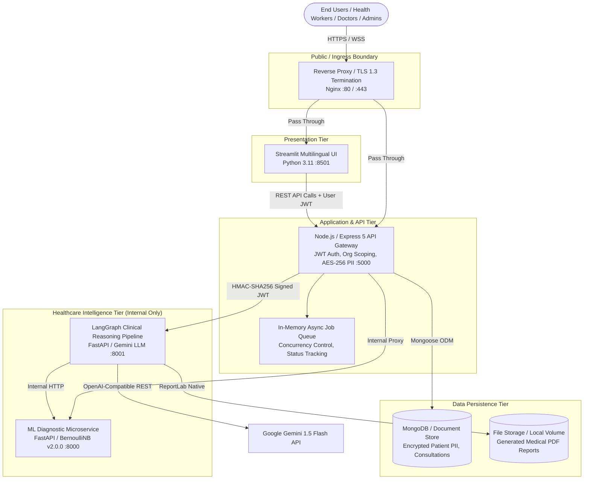
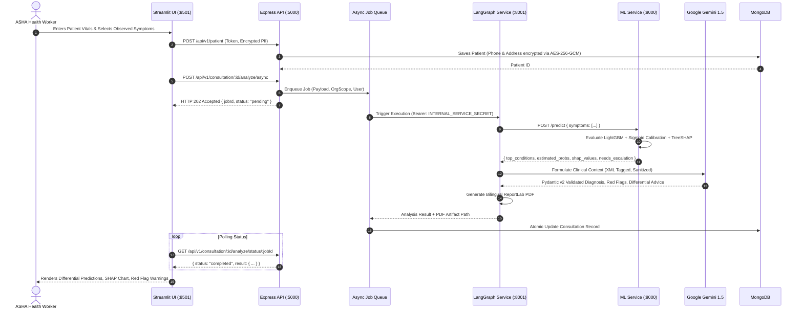

# ArogyaMitra — System Architecture Document

## 1. Executive Summary & Vision

**ArogyaMitra** (आरोग्यमित्र) is an open-source, privacy-first, AI-assisted primary healthcare decision support platform tailored for rural health centers and underserved communities. Designed to bridge the severe shortage of specialized medical professionals in rural India, the platform empowers Community Health Workers (e.g., ASHA workers) to collect structured symptom observations, obtain interpretable disease risk estimates via machine learning models, and escalate high-risk cases to Medical Officers via a human-in-the-loop review pipeline.

---

## 2. System Topology & Microservices Overview

The platform is architected around an event-driven, decoupled microservices model protected by an edge reverse proxy and fortified with defense-in-depth security.

### Component Roles & Responsibilities

| Service | Technology | Port | Access Scope | Primary Role |
| :--- | :--- | :--- | :--- | :--- |
| **Edge Proxy** | Nginx 1.25+ | `80`, `443` | Public | TLS termination, HSTS preloading, security headers, rate-limiting, internal port shielding. |
| **Frontend UI** | Streamlit 1.42+ | `8501` | Public via Proxy | Multilingual (EN/HI/MR) clinical workstation for Health Workers, Doctors, and Administrators. |
| **Backend API** | Node.js 20 / Express 5 | `5000` | Public via Proxy | Authentication, authorization, multi-tenant isolation, PII crypto, audit logging, queue orchestration. |
| **ML Inference** | FastAPI / LightGBM | `8000` | Internal Only | Probability estimation, TreeSHAP attributions, clinical uncertainty escalation detection. |
| **Graph Orchestrator** | FastAPI / LangGraph | `8001` | Internal Only | Multi-stage clinical reasoning, prompt-injection guarded LLM synthesis, bilingual PDF generation. |
| **Database** | MongoDB 7.0+ | `27017` | Internal Only | Field-level encrypted patient records, role-scoped consultations, audit trails, refresh tokens. |

---

## 3. Data Flow & Clinical Triage Workflow

---

## 4. Multi-Tenant Organization Scoping Model

To prevent horizontal privilege escalation and data cross-contamination between different healthcare jurisdictions (e.g., District Primary Health Centers, NGO clinics):

1. **Organization Fiduciary**: Every user, patient, and consultation record is strictly bound to an `organizationId` foreign key.
2. **Deterministic Context Injection**: In `Backend/src/middleware/auth.middleware.js`, the authenticated user's `organizationId` is extracted from verified JWT claims and attached to `req.user`.
3. **Org Scope Middleware**: In `Backend/src/middleware/orgScope.middleware.js`, any data access query automatically enforces `{ _id: resourceId, organizationId: req.user.organizationId }`.
4. **Anti-Enumeration 404s**: If an authenticated user from Organization A attempts to query or manipulate a resource belonging to Organization B, the API returns `404 Not Found` rather than `403 Forbidden`, completely denying the existence of external tenant records.

---

## 5. Security & Cryptographic Architecture

### 5.1 Storage Security (Data at Rest)
- **PII Field-Level Encryption**: Patient phone numbers, emergency contact details, and physical addresses are encrypted at rest using **AES-256-GCM** with 96-bit random initialization vectors (IV) and 128-bit authentication tags.
- **Argon2id Password Hashing**: Passwords are saved with memory-hard Argon2id (`timeCost: 3`, `memoryCost: 65536` KiB, `parallelism: 4`) with automatic legacy bcrypt upgrade on successful authentication.

### 5.2 Network Security (Data in Transit)
- **TLS 1.3 Termination**: Pure modern cipher suites (`TLS_AES_256_GCM_SHA384`, `TLS_CHACHA20_POLY1305_SHA256`).
- **HSTS Preloading**: Enforced via `max-age=63072000; includeSubDomains; preload`.
- **Inter-Service JWTs**: Node.js API signs internal payloads using HMAC-SHA256 with `INTERNAL_SERVICE_SECRET`. The internal Python services reject any unauthenticated requests with HTTP 401/403.

### 5.3 Clinical Safety Guardrails
- **Prompt Injection Neutralization**: All user symptom strings and medical history entries pass through regex sanitization stripping delimiter attacks, markdown exploits, and system directive overrides.
- **XML Data Isolation**: Medical facts are wrapped inside `<clinical_data>` delimiters in prompt templates.
- **Deterministic Clinical Fallback**: If the external Gemini LLM encounters rate limits, network timeouts, or malformed JSON output, the pipeline falls back immediately to a deterministic rule-based safety synthesizer (`llmFallback: true`) displaying the raw model predictions without stalling clinical workflows.

---

## 6. Technology Stack Specification

- **Core Runtime**: Node.js v20.x, Python 3.11.x, Nginx 1.25.x
- **Backend Framework**: Express 5.0.1, Mongoose 8.10.1, Zod 3.24.2, Argon2 0.41.1, Helmet 8.0.0
- **Machine Learning**: LightGBM 4.6.0, Scikit-learn 1.6.1, SHAP 0.46.0, Optuna 4.2.1, NumPy, Pandas
- **AI Orchestration**: FastAPI 0.115.8, LangGraph 0.3.5, Pydantic v2, ReportLab 4.3.1, Google Generative AI
- **Frontend Presentation**: Streamlit 1.42.2, Plotly 6.0.0, Requests
- **Test Automation**: Vitest 3.0.6 (Node.js), Pytest 8.3.4 (Python), Streamlit AppTest
