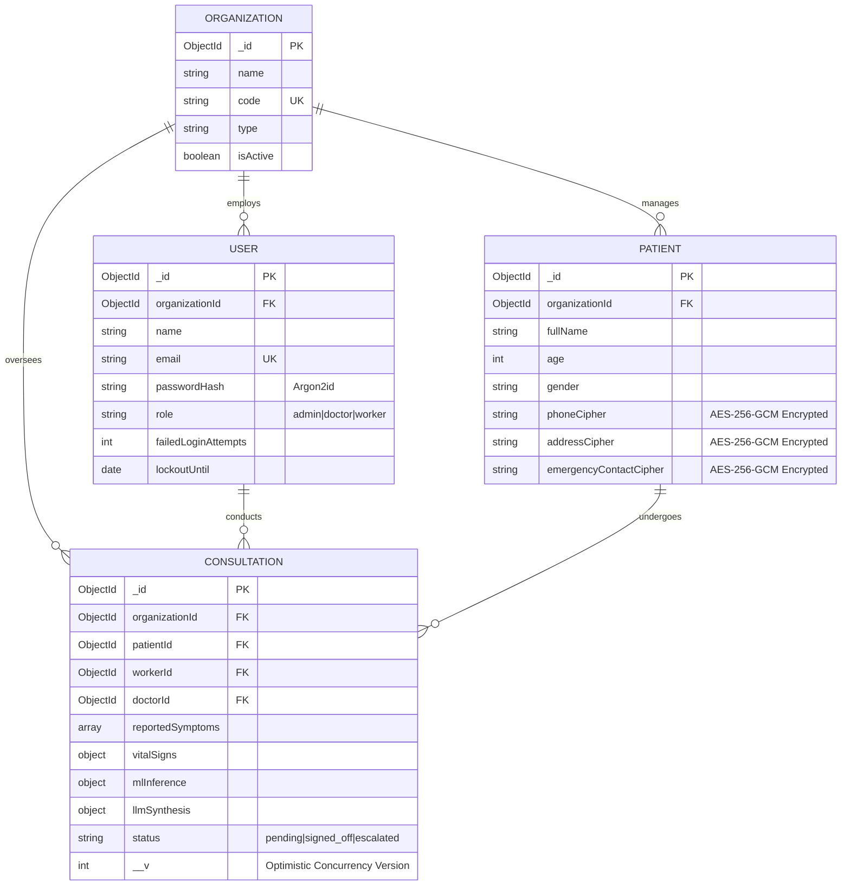

# Chapter 3: System Design & Architecture

## 3.1 Architectural Principles

ArogyaMitra is architected according to five foundational engineering principles:
1. **Decoupled Microservices**: Diagnostic intelligence, clinical reasoning orchestration, business logic, and presentation tiers execute in isolated processes with well-defined contracts.
2. **Defense-in-Depth Security**: Cryptographic validation at every boundary (TLS 1.3 at ingress, HMAC JWTs for inter-service RPCs, AES-256-GCM at rest, Argon2id for authentication).
3. **Fail-Safe Clinical Resilience**: AI pipeline failures must never halt primary care workflows; deterministic fallbacks guarantee actionable triage outputs.
4. **Zero-Knowledge Multi-Tenancy**: Data access strictly scoped by fiduciary organization boundaries, with anti-enumeration 404 responses.
5. **Human-in-the-Loop Governance**: AI acts strictly as an advisory decision support instrument; legal and clinical sign-off remains with licensed Medical Officers.

---

## 3.2 Service Components & Technical Specifications

### 3.2.1 Edge Reverse Proxy (Nginx)
- **Role**: Ingress gateway, TLS 1.3 termination, rate-limiting, and network isolation.
- **Port Mapping**: Binds to public `:80` and `:443`. Shields internal ports (`:5000`, `:8000`, `:8001`) from external exposure.
- **Security Headers**: HSTS (`max-age=63072000`), CSP, `X-Content-Type-Options: nosniff`, `X-Frame-Options: DENY`.

### 3.2.2 Backend Gateway (Node.js & Express 5)
- **Role**: User authentication, role-based authorization, multi-tenant scoping, AES-256-GCM encryption, and asynchronous queue management.
- **Data Store**: MongoDB with Mongoose ODM (`optimisticConcurrency: true`).
- **Security Middleware**:
  - `argon2id` with automatic legacy `bcrypt` migration.
  - Refresh token rotation with reuse detection revoking compromised token families.
  - Express 5-compatible recursive NoSQL injection sanitizer.
  - Rate limiters: 15 req/15min for authentication, 150 req/min for general API.

### 3.2.3 ML Diagnostic Microservice (FastAPI & LightGBM)
- **Role**: Low-latency calibrated probability inference and TreeSHAP feature attributions.
- **Input Vector**: 131 binary symptoms vector ($x \in \{0, 1\}^{131}$).
- **Inference Pipeline**:
  1. Input validation against canonical symptom dictionary.
  2. LightGBM multi-class margin prediction.
  3. Sigmoid/Platt Scaling post-hoc probability calibration.
  4. TreeSHAP computation via `shap.TreeExplainer`.
  5. Clinical uncertainty heuristic evaluation (triggering auto-escalation).

### 3.2.4 LangGraph Clinical Reasoning Service (FastAPI & Python)
- **Role**: Multi-stage clinical reasoning, prompt-injection guarded LLM synthesis, and bilingual PDF generation.
- **Workflow Graph**:
  - `input_validation_node`: Sanitizes input text, checks for prompt injection attempts.
  - `ml_inference_node`: Invokes ML microservice over authenticated internal HTTP.
  - `llm_reasoning_node`: Synthesizes clinical notes with Google Gemini 1.5 Flash using XML `<clinical_data>` tagging and Pydantic v2 schemas.
  - `fallback_node`: Activates on timeout or schema violation, providing deterministic clinical summaries.
  - `report_node`: Compiles patient demographics, calibrated probabilities, TreeSHAP charts, and physician sign-off lines into a bilingual ReportLab PDF.

### 3.2.5 Multilingual Clinical Workstation (Streamlit)
- **Role**: Rapid, responsive, accessible interface for frontline workers and doctors.
- **Modules**:
  - `Home.py`: System health telemetry, language selector (English, Hindi, Marathi), regulatory disclaimer.
  - `1_Worker_Triage.py`: Patient vitals entry, 131-symptom multiselect with presets, calibrated probability display, TreeSHAP Plotly bar chart, red-flag banners, PDF download.
  - `2_Doctor_Review.py`: Case review queue, full symptom history, physician verdict and prescription entry, referral routing.
  - `3_Admin_Dashboard.py`: Operational KPIs, disease prevalence donut chart, job queue telemetry, cryptographic security status, immutable audit logs.

---

## 3.3 Database Schema Design & Multi-Tenancy

